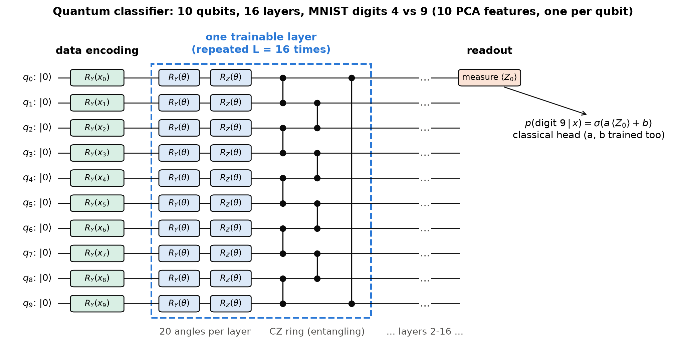
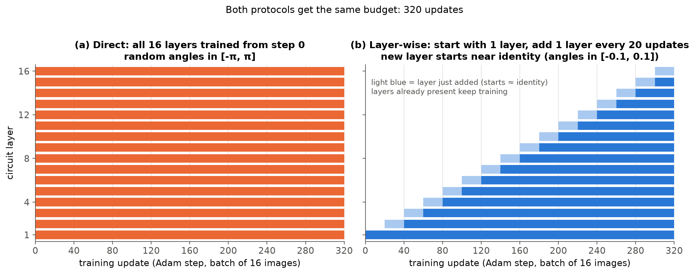
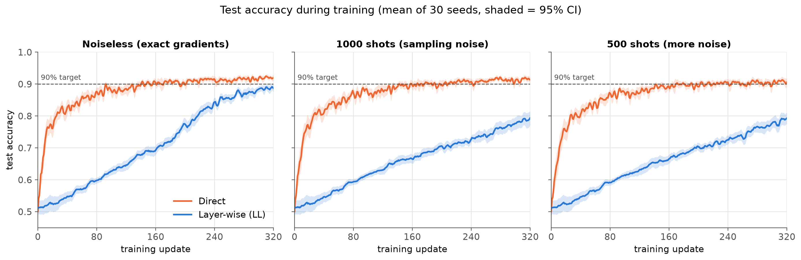
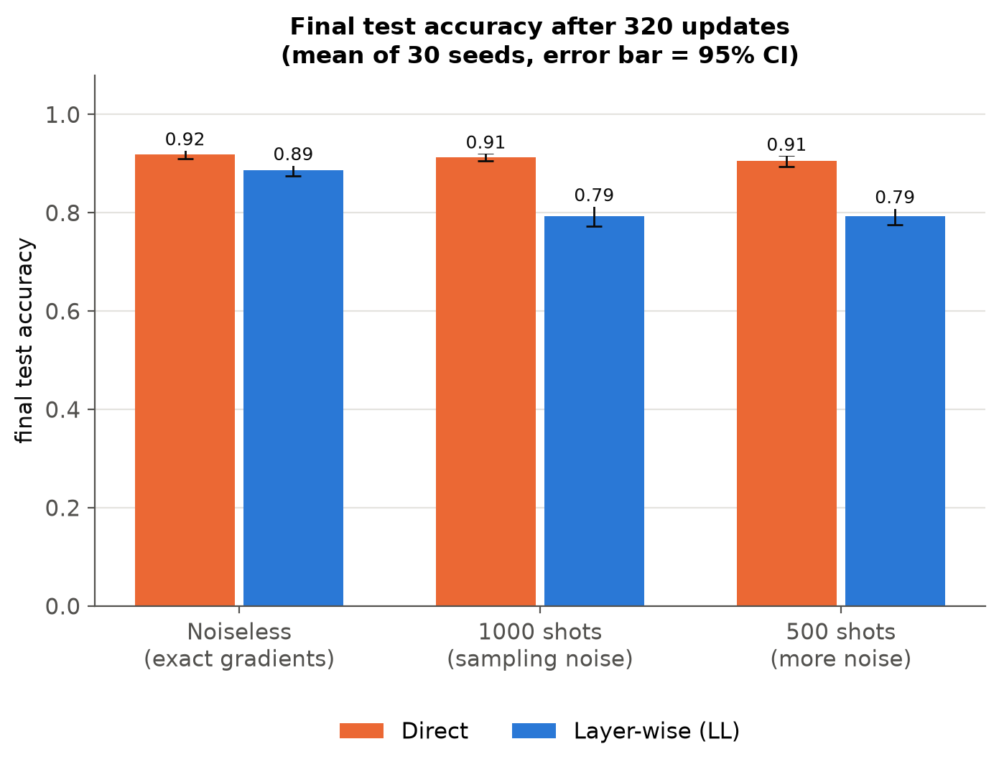
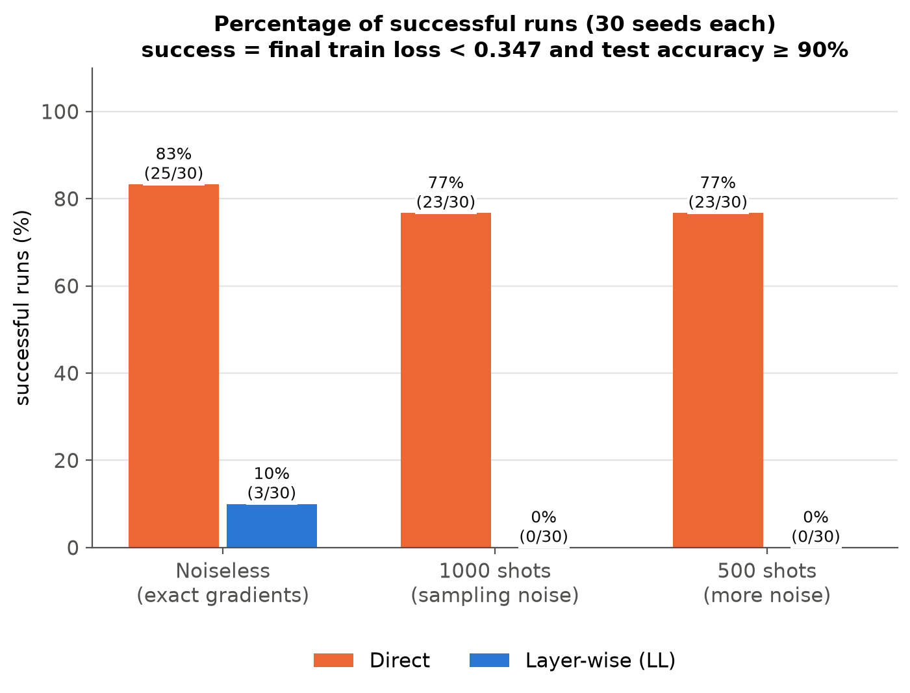
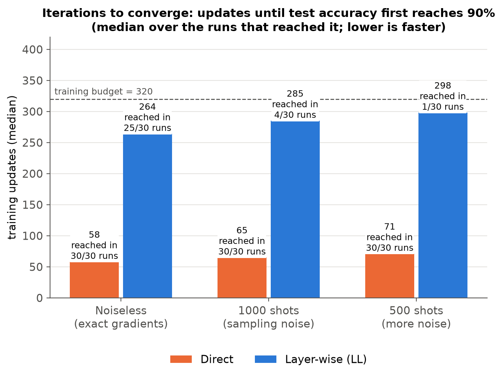
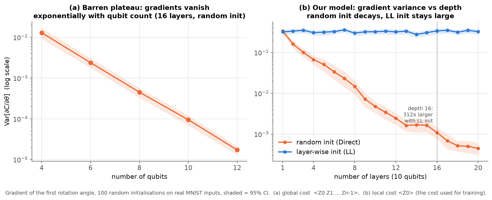

# Layer-wise Learning vs Direct Training of a Variational Quantum Classifier

This file is the complete explanation of the project. The code is in `notebook/layerwise_vs_direct.ipynb`
(interactive) and `src/`.

---

## 1. The problem in one paragraph

A **variational quantum circuit (VQC)** is a quantum circuit with adjustable rotation angles θ. The quantum
computer evaluates the circuit, and a classical optimiser (here Adam) changes θ to reduce a cost. This works
only if the gradient ∂C/∂θ carries a signal. A **barren plateau** is when the cost landscape becomes almost
flat: for deep circuits with random angles, the gradients shrink exponentially with the number of qubits
(and with depth), so the optimiser cannot tell which way to go.

**Layer-wise learning (LL)** (Skolik et al., 2021) is a proposed fix. Training starts with a shallow circuit,
which has large gradients, and layers are added one by one during training. New layers start close to the
identity, so they do not destroy what has already been learned.

We **compare LL with Direct training** of the fixed full-depth circuit.

| Objective | What we did | Where |
|---|---|---|
| O1: choose a QML task | MNIST digits 4 vs 9, 10 qubits, 16-layer circuit | Sections 2-3 |
| O2: two protocols | (a) Direct, (b) Layer-wise, same budget | Section 4 |
| O3: compare accuracy, iterations to converge, noise sensitivity | 30 seeds each, noiseless + 1000 shots + 500 shots | Section 6 |
| Analysis | Barren-plateau diagnostic, plus the reasons for the outcome | Sections 6-7 |

---

## 2. Task and data (O1)

* **Dataset:** real MNIST (OpenML `mnist_784`), digits **4 vs 9**. We chose this pair because it is one of the
  most confusable digit pairs, so the task is not trivial.
* **Subsets (balanced, disjoint):**
  * 600 training images, 200 validation images (both from the official training set);
  * 400 test images (from the official test set).
* **Preprocessing:**
  1. 28×28 → 14×14 by averaging 2×2 blocks.
  2. PCA → **10 features** (65% of the variance).
  3. Scale each feature to an angle in [0, π].
  * PCA and the scaler are fitted on the training images only.
* **One feature per qubit** → 10 qubits.

---

## 3. The quantum neural network



| Part | What it does |
|---|---|
| Encoding | `RY(x_q)` on qubit q: each image becomes a 10-qubit product state |
| Trainable layer (×16) | `RY(θ)` and `RZ(θ)` on every qubit (20 angles), then a ring of CZ gates (entanglement) |
| Readout | ⟨Z₀⟩ = expectation value of Pauli-Z on qubit 0, a number in [-1, 1] |
| Classical head | p(digit 9) = sigmoid(a·⟨Z₀⟩ + b), with a and b also trained |
| Loss / optimiser | binary cross-entropy; Adam, learning rate 0.03, batch of 16 images |

* **Parameter count:** 16 layers × 10 qubits × 2 = **320 circuit angles**, plus a and b.
* **Simulators:** the model is defined in PennyLane (`src/circuit.py`). The 180 training runs used a fast
  PyTorch simulator of exactly the same circuit (`src/fastsim.py`), because PennyLane's generic simulator was
  too slow. The two agree to about 10⁻¹⁶ (checked in the notebook).
* **Why CZ:** CZ gates commute with the Z readout. A new layer whose angles are 0 therefore leaves the output
  *exactly* unchanged, which is what "start new layers near identity" needs.

---

## 4. The two training protocols (O2)



| | Direct | Layer-wise (LL) |
|---|---|---|
| Start | all 16 layers, every angle random in [-π, π] | 1 layer, with the same random angles as Direct's first layer |
| Growth | none | every 20 updates, add 1 layer with angles in [-0.1, 0.1] (≈ identity) |
| Which layers train | all 16 | all layers present so far |
| Budget | 320 updates | 320 updates (16 stages × 20) |

* **Same budget:** both protocols get the same number of optimiser updates, so the comparison is fair.
* **Paired seeds:** seed k gives both methods the same first layer and the same sequence of mini-batches.
* **Layer freezing:** Skolik et al. also *freeze* old layers while new ones train. We keep all present layers
  trainable, which matches the brief: "start with the first layer trained, then successively add layers". It
  is also simpler.

---

## 5. Noise: training with a limited number of shots

On real hardware, ⟨Z₀⟩ is estimated from S measurements (shots), so every value is noisy (std ≈ 1/√S).
We trained each protocol in three settings:

| Setting | Gradients |
|---|---|
| Noiseless | exact |
| 1000 shots | parameter-shift rule with every circuit value estimated from 1000 shots |
| 500 shots | parameter-shift rule with every circuit value estimated from 500 shots (more noise) |

* **Parameter-shift rule:** ∂f/∂θ = [f(θ+π/2) − f(θ−π/2)] / 2. This is how gradients are measured on a
  quantum computer.
* **Shot simulation:** the number of +1 outcomes is drawn from a binomial distribution. This is the exact
  statistics of a real device.
* **How accuracy is measured:** noise affects *training*. Final accuracy is computed exactly, so it measures
  how good the learned model is.

---

## 6. Results (O3)

Each setting has 30 seeds per method, 180 runs in total.

| Noise | Method | Test accuracy (±95% CI) | Successful runs | Median updates to reach 90% test accuracy |
|---|---|---|---|---|
| Noiseless | **Direct** | **0.920 ± 0.009** | **25/30 (83%)** | **58** (reached in 30/30 runs) |
| Noiseless | Layer-wise | 0.887 ± 0.011 | 3/30 (10%) | 264 (25/30) |
| 1000 shots | **Direct** | **0.914 ± 0.009** | **23/30 (77%)** | **65** (30/30) |
| 1000 shots | Layer-wise | 0.794 ± 0.021 | 0/30 (0%) | 285 (4/30) |
| 500 shots | **Direct** | **0.906 ± 0.012** | **23/30 (77%)** | **71** (30/30) |
| 500 shots | Layer-wise | 0.793 ± 0.018 | 0/30 (0%) | 298 (1/30) |

**Definitions**
* **Success:** final training loss < 0.347 (half the loss of a coin flip, ln2 / 2) *and* test accuracy ≥ 90%.
* **Iterations to converge:** the first update at which test accuracy reaches 90%.

**Significance:** Direct was better than LL for the same seed in 28/30 (noiseless), 30/30 and 30/30 seeds.
* Paired Wilcoxon test on accuracy: p < 10⁻⁵ in all three settings.
* Fisher test on success rates: p < 10⁻⁷ in all three settings.

### Graphs

**Test accuracy during training** (mean of 30 seeds, shaded = 95% CI):



* Direct passes 90% within about 60 updates.
* LL climbs slowly while the circuit is still shallow. Without noise it almost catches up by the end; with
  shots it does not.

| Final accuracy | Success rate | Iterations to converge |
|---|---|---|
|  |  |  |

**Sensitivity to sampling noise:**
* Direct: 0.920 → 0.914 → 0.906 (almost unaffected).
* LL: 0.887 → 0.794 → 0.793 (loses about 9 percentage points).

---

## 7. Analysis: what the results mean

### 7.1 The barren plateau is real, and LL's initialisation avoids it



Gradient variance was measured over 100 random initialisations on real MNIST inputs.

* **(a) Global cost ⟨Z₀Z₁…Z₉⟩:** the variance falls exponentially with qubit count, from 1.3×10⁻² at 4 qubits
  to 1.7×10⁻⁵ at 12 qubits. This is the textbook barren plateau.
* **(b) Our model, random initialisation:** the variance falls about **300×** from 1 layer to 16 layers.
* **(b) Our model, layer-wise initialisation:** the variance stays at the 1-layer value (≈0.3) at any depth.
  The near-identity layers keep the circuit "effectively shallow" at the start.

This confirms the idea of Skolik et al.: keeping the circuit shallow at first keeps the gradient signal large
compared with the noise.

### 7.2 Why LL still did not beat Direct here

1. **Direct is not stuck on a plateau at this size.**
   * At 10 qubits with a *local* readout (⟨Z₀⟩), Direct's gradient variance (≈10⁻³) is small but still
     usable.
   * Fig. 4 shows no flat start: Direct learns immediately.
   * Even with 500 shots its accuracy barely drops, so the noise never drowned its gradients.
   * The plateau that LL fixes is not what limits training here.
2. **Shallow circuits cannot see the whole image (the light cone).**
   * With readout on qubit 0 and nearest-neighbour CZ gates, a depth-d circuit is influenced by only
     **2d − 1** of the 10 input features (verified numerically).
   * So LL's first layers can use only 1, 3, 5, … features, and cannot separate 4 from 9 well. The training
     loss stays near 0.68 for the first ~100 updates.
   * With the same budget of 320 updates, LL reaches full depth only in the last 20 updates.
3. **LL's gradients become small, so shot noise hurts it more.**
   * After the first few updates, a shallow circuit has already learned what it can, so its gradients are
     small.
   * Mean |gradient| per parameter at update 40 is 0.0018 for LL vs 0.0068 for Direct (about 4× smaller).
   * The same shot noise is therefore much larger *relative* to LL's signal. That is why LL lost about 9
     points with shots while Direct lost less than 2.

### 7.3 Conclusion

* Both protocols were designed, implemented and compared on a real MNIST task, under exact and finite-shot
  training.
* The barren-plateau diagnostic shows clearly why layer-wise learning is proposed: it keeps the gradients of
  deep circuits large.
* However, **at the size we can simulate (10 qubits, 16 layers, local cost), Direct training did not hit a
  barren plateau.** Direct beat LL on accuracy, convergence speed, success rate and robustness to sampling
  noise, and all differences are statistically significant.
* So the expected advantage of LL was **not** reproduced in this regime.
* LL should pay off where Direct really stalls: many more qubits, global costs, or much deeper circuits,
  which cannot be simulated on a laptop. Giving LL extra updates at each depth is another option.

### 7.4 Limitations

* There is one dataset pair and one circuit design (local readout, CZ ring).
* Only one LL variant was tested: joint training with 20 updates per layer.
* Hardware noise (decoherence) is not modelled; only sampling noise is.
* The learning rate (0.03) was chosen by a small validation sweep (0.01 / 0.03 / 0.1) and is the same for both
  methods.

---

## 8. How we checked that everything is correct

| Check | Result |
|---|---|
| Fast simulator vs PennyLane: outputs, gradients and parameter-shift values | agree to about 10⁻¹⁶ |
| Shot sampling | unbiased; variance matches the theory (1 − f²)/S |
| Zero-angle layer appended to the circuit | output change exactly 0 |
| Light cone: features influencing ⟨Z₀⟩ at depth d | exactly 2d − 1 |
| All 180 saved runs: settings, data split, layer schedule, success flags, iterations | all consistent |
| Saved final models re-evaluated on the test set | every test accuracy reproduced exactly |
| Seed 0 of both methods retrained from scratch | same test accuracy as the saved runs, training loss equal to 10⁻⁷ (notebook, `RUN_DEMO = True`) |

---

## 9. Likely viva questions

* **What is a barren plateau?** The gradient variance shrinks exponentially with qubit count, so gradients
  are almost zero everywhere and the optimiser gets no direction.
* **How does LL help?** A shallow circuit has large gradients. Adding near-identity layers keeps the circuit
  effectively shallow, so training never starts on a plateau.
* **Why near-identity?** A new layer that is (almost) the identity does not change what the circuit has
  already learned, so adding it cannot make the model worse. Small random angles in [-0.1, 0.1] keep the
  output almost unchanged while giving each new gate a slightly different starting point.
* **Why does a zero layer not change the output?** RY(0) = RZ(0) = I, and the CZ ring commutes with Z₀, so it
  cannot change ⟨Z₀⟩.
* **Why did LL lose?** At 10 qubits Direct has no plateau. LL wastes budget on shallow circuits that see only
  2d − 1 features, and its small gradients are hurt more by shot noise.
* **Is the comparison fair?** Yes. Both methods get the same 320 updates, the same data, the same learning
  rate, and paired seeds.
* **What is the parameter-shift rule?** It is an exact gradient from two circuit runs: (f(θ+π/2) − f(θ−π/2))/2.
* **Why local cost?** A global cost (Z on all qubits) has a plateau even at shallow depth, which would make
  both methods fail. A local cost is the standard trainable choice.

---

## 10. Files and how to run

```
README.md                 this explanation
notebook/                 layerwise_vs_direct.ipynb   (interactive, executed)
src/config.py             all settings
src/data.py               MNIST loading and preprocessing
src/circuit.py            the PennyLane model
src/fastsim.py            fast simulator of the same circuit (+ shot sampling)
src/train.py              Direct and Layer-wise training, Adam, parameter-shift with shots
src/runner.py             runs and saves training jobs
src/gradients.py          barren-plateau diagnostic
src/figures.py            summary table and all figures
run_all.py                one command per step
results/runs/             {noiseless, shots1000, shots500}/{direct, ll}/seed_XXX.json  (180 runs)
results/diagnostic/       bp_diagnostic.json
results/summary.csv       the results table
figures/                  the 7 figures
data/mnist_784.npz        real MNIST
requirements.txt          Python packages
```

Setup (Windows, Python 3.11):

```powershell
py -3.11 -m venv .venv
.\.venv\Scripts\python.exe -m pip install -r requirements.txt
```

Run:

```powershell
.\.venv\Scripts\python.exe run_all.py figures      # table + figures from the saved results (~1 min)
.\.venv\Scripts\python.exe run_all.py train        # all 180 training runs (~5 h; finished runs are skipped)
.\.venv\Scripts\python.exe run_all.py diagnostic   # barren-plateau diagnostic
```

**Reference:** A. Skolik, J. R. McClean, M. Mohseni, P. van der Smagt, M. Leib, "Layerwise learning for
quantum neural networks", *Quantum Machine Intelligence* 3, 5 (2021).
